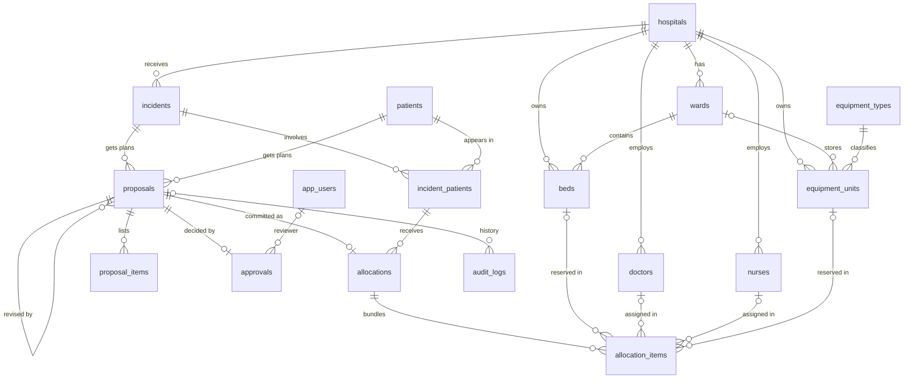

# Entity relationship design (Phase 2)

Fictional data only. Not clinically validated.

## Diagram

`policy_settings` (configurable validator limits) and `schema_migrations` (migration
bookkeeping) stand alone.

## How the tables relate

| Table | Purpose | Key relationships |
|---|---|---|
| `hospitals` | Identity, location, status, `max_concurrent_patients` cap | Parent of almost everything |
| `wards` | Ward type, capacity, open/closed | Belongs to a hospital |
| `nurses`, `doctors` | Staff, shift, availability, `state_version` | Belong to a hospital |
| `beds` | Bed type and status (`free`, `reserved`, `occupied`, `cleaning`, `out_of_service`) plus version | Belong to a ward **and** the same hospital |
| `equipment_types`, `equipment_units` | Each physical unit tracked individually (status, maintenance date, version) | Unit belongs to a hospital; optional ward in that hospital |
| `patients` | Fictional patients (the database refuses `is_fictional = FALSE`) | Linked to incidents |
| `incidents`, `incident_patients` | Emergency, reported severity, arrival time, status, Agent A extraction (JSONB) | Incident belongs to the receiving hospital; many patients per incident |
| `proposals` | AI plans: input snapshot, validation errors/warnings, unmet requirements, explanation, alternatives (`parent_proposal_id`, `plan_label`) | Bundle proposals point to an incident and patient |
| `proposal_items` | One row per resource the AI proposed | `resource_id` has **no** foreign key, so invalid AI suggestions stay auditable |
| `approvals` | Reviewer decision: approved, rejected, or revision requested | One decision per proposal; optional link to `app_users` |
| `allocations` | The complete committed bundle for one patient of one incident | Created from exactly one proposal |
| `allocation_items` | The bed, doctor(s), nurse(s), equipment unit(s) in the bundle | Each item references exactly one resource in the same hospital |
| `audit_logs` | Append-only history with actor and entity | Optional link to a proposal |
| `app_users` | Administrators and reviewers (hash column filled in the auth phase) | Referenced by approvals |
| `policy_settings` | Workload limits and demo policy placeholders read by the validator | None |

## Rules the database enforces by itself

| Rule | Mechanism |
|---|---|
| A resource belongs to the same hospital as its ward / allocation | Composite foreign keys `(id, hospital_id)` |
| A patient can only be allocated under an incident they belong to | Composite FK to `incident_patients` |
| A bed or equipment unit has at most one **active** allocation | Partial unique indexes (`WHERE status = 'active'`) |
| A patient has at most one active allocation; an allocation has at most one active bed | Partial unique indexes |
| An allocation item fills exactly the column matching its `resource_type` | CHECK `exactly_one_resource` |
| Active allocations have no end time; ended ones do | CHECK `active_means_not_ended` |
| A ward holds no more beds than its capacity; bed type matches ward type | Trigger `enforce_ward_rules` |
| Only fictional patients can be stored | CHECK `patients_must_be_fictional` |
| An invalid proposal can only ever have status `rejected_by_validator` | CHECK `status_matches_validation` (from migration 001) |
| Each proposal is decided at most once | `UNIQUE (proposal_id)` on approvals |
| Audit rows cannot be edited or deleted | Trigger `audit_logs_are_append_only` |

## Design decisions to know about

- **Per-row versions.** Beds, doctors, nurses and equipment units each carry a `state_version`, increased on every change. A proposal item remembers the version the *backend* read.
- **Cleaning is part of bed `status`.** A separate cleaning column could contradict the status, so `'cleaning'` is one of its values.
- **Doctors and nurses may serve several patients.** Their limit comes from `policy_settings`, not a unique index. Beds and equipment units are exclusive.
- **Workload is derived, not stored.** Active patients per staff member are counted from active `allocation_items`, avoiding a duplicate counter that could drift.
- **Not yet enforced by the database (Phase 5-6, Python):** hospital capacity vs `max_concurrent_patients`, workload limits, ICU eligibility policy, shift matching, and "required components present". Reasons: they depend on configurable policy or on counting across rows.
- **`TRUNCATE` bypasses the audit-log trigger.** Real protection will also need a restricted database role for the API (later phase); test and demo-reset tooling deliberately truncate.
